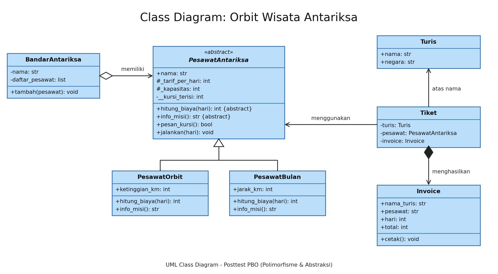
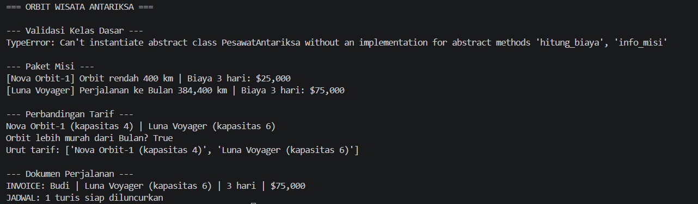

# Laporan Posttest Praktikum PBO 3 (Abstraksi & Polimorfisme)
**Tema:** Orbit Wisata Antariksa
Program simulasi agen wisata antariksa. Program menghitung biaya perjalanan yang berbeda untuk tiap jenis pesawat (orbit rendah dan perjalanan ke Bulan), memesan tiket untuk turis, lalu mencetak invoice dan jadwal peluncuran.

## 1. Relasi UML (Class Diagram)



**Penjelasan Relasi:**

* **Asosiasi (Tiket -> Turis & PesawatAntariksa):** Class `Tiket` hanya merujuk ke objek `Turis` yang memesan dan `PesawatAntariksa` yang dipakai (`self.turis`, `self.pesawat`). Keduanya berdiri sendiri dan tidak dimiliki oleh `Tiket`.
* **Agregasi (BandarAntariksa o-- PesawatAntariksa):** Class `BandarAntariksa` memiliki penampung (`daftar_pesawat`) untuk mengumpulkan banyak objek pesawat yang dibuat di luar kelasnya, lalu dimasukkan lewat `tambah()`. Relasi ini dipilih karena jika bandar ditutup atau dihapus dari memori, objek pesawat tetap ada dan bisa dipindah ke bandar lain.
* **Komposisi (Tiket *-- Invoice):** Class `Tiket` membuat objek `Invoice` langsung di dalam `__init__` miliknya. Relasi ini dipilih karena `Invoice` tidak memiliki arti tanpa tiketnya, sehingga ikut hilang jika objek `Tiket` dihapus.
* **Pewarisan (PesawatOrbit & PesawatBulan -> PesawatAntariksa):** Kedua subclass mewarisi atribut dan method dari abstract class `PesawatAntariksa` lewat `super().__init__(...)`.

## 2. Penerapan Abstraksi

Sistem mengimplementasikan modul `abc` pada superclass `PesawatAntariksa`, menjadikannya Abstract Base Class.

* **Abstract Method:** Terdapat dua method wajib, yaitu `@abstractmethod hitung_biaya()` dan `@abstractmethod info_misi()`. Keduanya diimplementasikan (di-override) oleh `PesawatOrbit` dan `PesawatBulan`.
* **Method Konkret:** `PesawatAntariksa` memiliki method `jalankan(hari)` yang langsung dipakai bersama oleh semua subclass tanpa perlu ditulis ulang. Method ini memanggil `info_misi()` dan `hitung_biaya()` milik subclass masing-masing.
* **Atribut Protected dan Private:** `_tarif_per_hari` dan `_kapasitas` bersifat protected. `__kursi_terisi` bersifat private, dibaca lewat property `kursi_terisi` dan diubah lewat `pesan_kursi()`.
* **Bukti:** Jika class `PesawatAntariksa` diinstansiasi langsung, terminal memunculkan `TypeError` yang sengaja ditangkap dengan blok `try-except` di awal jalannya program.

## 3. Penerapan Polimorfisme

* **Polimorfisme via Pewarisan:** Subclass `PesawatOrbit` dan `PesawatBulan` masing-masing meng-override `hitung_biaya()` (orbit: tarif x hari + biaya pelatihan 10.000, bulan: tarif x hari x 1,25 untuk tambahan radiasi) serta `info_misi()`. Keduanya dipanggil lewat satu perulangan `for` sederhana tanpa pengecekan tipe (`type()`) maupun rantai `if/elif`.
* **Duck Typing:** Terdapat dua class independen yang tidak saling mewarisi, yaitu `Invoice` dan `JadwalPeluncuran`. Keduanya memiliki method bernama sama, yakni `cetak()`. Fungsi global `tampilkan(dokumen)` menerima objek dari class mana pun dan menjalankannya tanpa peduli jenis class-nya, asalkan method tersebut tersedia.
* **Operator Overloading:** Class `PesawatAntariksa` mengimplementasikan `__str__` (tampilan `nama (kapasitas N)`), `__lt__` (membandingkan tarif per hari, dipakai oleh `<` dan `sorted()`), dan `__eq__` (dua pesawat sama jika namanya sama).

## 4. Nilai Plus: Penerapan Prinsip SOLID

Program ini menerapkan dua prinsip SOLID.

* **Open/Closed Principle (OCP):** Menambah jenis pesawat baru, misalnya `PesawatMars`, cukup dengan membuat subclass baru dari `PesawatAntariksa` yang mengimplementasikan `hitung_biaya()` dan `info_misi()`. Kode `BandarAntariksa`, `Tiket`, dan perulangan pemanggilan `jalankan()` tidak perlu diubah dan tidak perlu rantai `if/elif`.
* **Dependency Inversion Principle (DIP):** `Tiket` menerima parameter bertipe abstraksi `PesawatAntariksa`, bukan kelas konkret `PesawatOrbit` atau `PesawatBulan`, sehingga bisa dipakai untuk pesawat jenis apa pun yang mengikuti kontrak abstract class-nya.

## 5. Output Eksekusi Terminal



```
=== ORBIT WISATA ANTARIKSA ===

--- Validasi Kelas Dasar ---
TypeError: Can't instantiate abstract class PesawatAntariksa without an implementation for abstract methods 'hitung_biaya', 'info_misi'

--- Paket Misi ---
[Nova Orbit-1] Orbit rendah 400 km | Biaya 3 hari: $25,000
[Luna Voyager] Perjalanan ke Bulan 384,400 km | Biaya 3 hari: $75,000

--- Perbandingan Tarif ---
Nova Orbit-1 (kapasitas 4) | Luna Voyager (kapasitas 6)
Orbit lebih murah dari Bulan? True
Urut tarif: ['Nova Orbit-1 (kapasitas 4)', 'Luna Voyager (kapasitas 6)']

--- Dokumen Perjalanan ---
INVOICE: Budi | Luna Voyager (kapasitas 6) | 3 hari | $75,000
JADWAL: 1 turis siap diluncurkan
```
